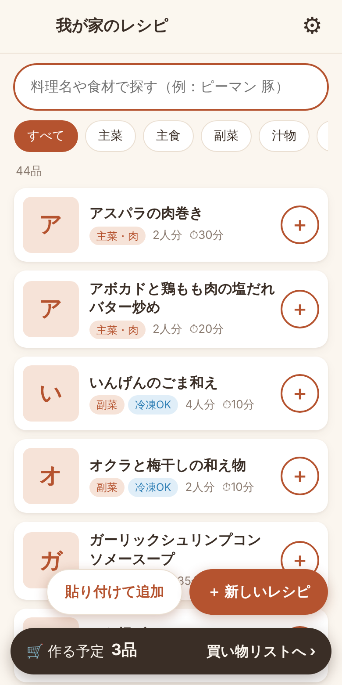
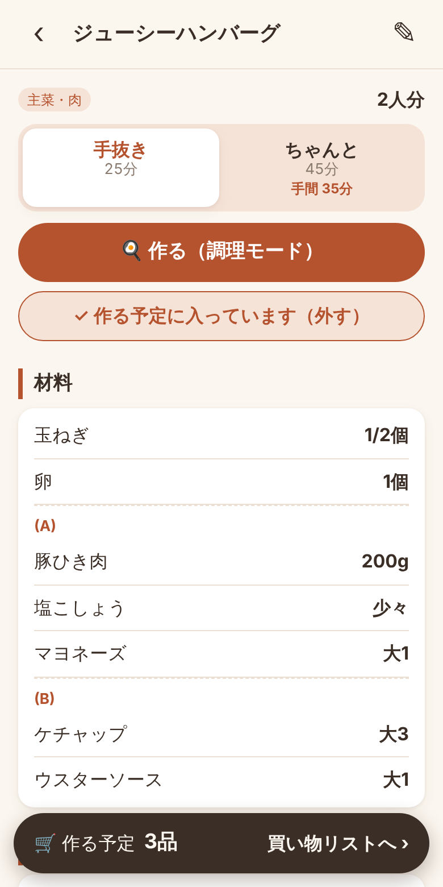
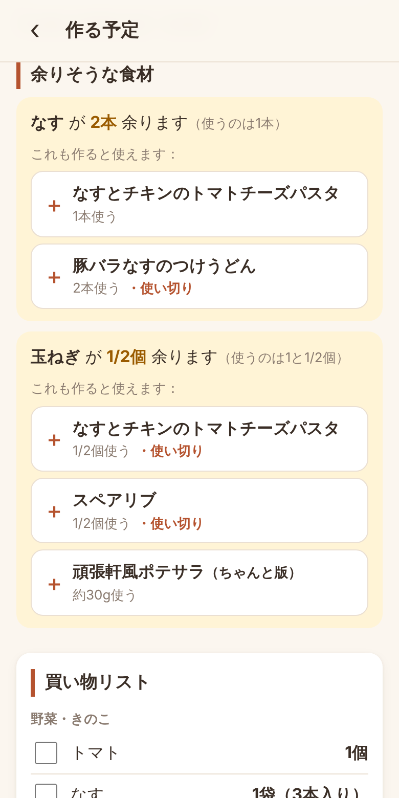
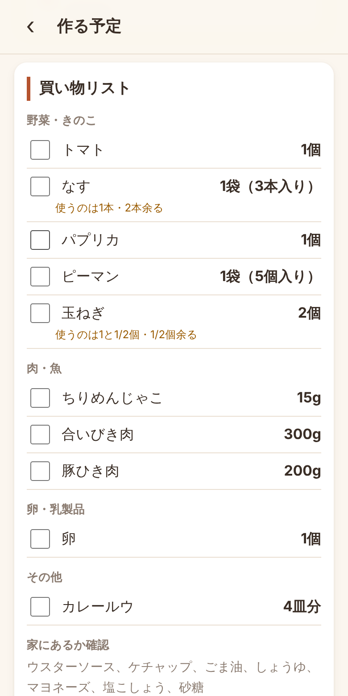
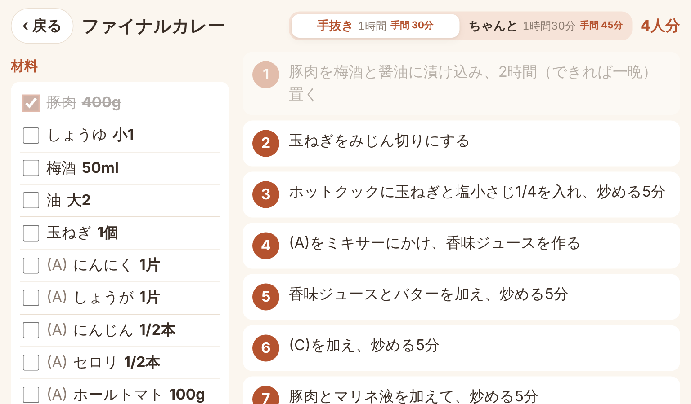

# 我が家のレシピ

Markdownで書いたレシピ集を、スマホで見て、その場で直して、何人かで共有できるレシピアプリです。
**GitHubだけで動きます**（サーバー・データベース・ほかのサービスの登録は不要、無料）。

<p>




</p>

## できること

- **レシピを見る・探す**：料理名や食材で検索（「人参」で「にんじん」も見つかる）。分類や冷凍OKで絞り込み
- **その場で直す**：調味料を変えたら、スマホで書き換えて保存。前の分量は「変更の履歴」に残り、戻すこともできる
- **写真を残す**：作った料理の写真をレシピに追加
- **手抜き版／ちゃんと版**：1つのレシピに2通りの作り方を持たせて切り替え。それぞれの所要時間と、手を動かす時間（手間）も表示
- **栄養（1人分）**：カロリー・たんぱく質・脂質・炭水化物・糖質・食物繊維・塩分
- **作る予定と買い物リスト**：作りたい料理を選ぶと、売り場ごとの買い物リストを作る。「玉ねぎが1/2個余ります」のように**余りそうな食材を知らせて、それを使い切れるレシピを提案**する
- **何人かで共有**：招待した人とレシピも作る予定も共有。誰かが選んだ献立をほかの人が直したり、買い物中に別々にチェックしたりできる
- **調理モード**：大きな文字、画面が消えない、材料と手順のチェック。横長の画面では材料と手順を左右に並べる
- **貼り付けて追加**：雑誌やテレビのレシピの写真、話した内容を Claude などのAIでこの形式に整えてもらい、貼り付けて取り込む



## はじめかた（10分くらい）

### 1. このリポジトリをコピーする
右上の **Fork** で、自分のアカウントにコピーします。

> 公開リポジトリとして作られます。レシピや作る予定の中身は誰でも見られる状態になるので、見られて困ることは書かないでください（GitHubの無料プランでは、非公開リポジトリから GitHub Pages を公開できません）。

### 2. スマホ版を公開する
1. コピーしたリポジトリの **Settings → Pages** で、Build and deployment の Source を **GitHub Actions** にする
2. **Actions** タブを開き、ワークフローを有効にする（Fork したリポジトリでは最初は止まっています）
3. 「スマホ版を更新」→ **Run workflow** を押す
4. 1〜2分で `https://（あなたのユーザー名）.github.io/（リポジトリ名）/` で開けるようになります。スマホのブラウザで開いて「ホーム画面に追加」すると、アプリのように使えます

保存先のリポジトリは自動で決まるので、コードを書き換える必要はありません。

### 3. 編集用の鍵を登録する
見るだけなら不要です。編集・写真の追加・作る予定を使う端末で、一度だけ登録します。

1. https://github.com/settings/personal-access-tokens/new を開く
2. Token name は `レシピアプリ` など、Expiration は長め
3. Repository access：**Only select repositories** → このリポジトリだけを選ぶ
4. Repository permissions の **Contents** を **Read and write** にする
5. 「Generate token」で出てきた `github_pat_…` をコピーし、アプリの **設定 → 編集用の鍵** に貼り付ける

鍵はこのリポジトリを書き換えるための合言葉なので、人に見せないでください。端末をなくしたときは、同じページで鍵を削除すれば使えなくなります。

### 4. 自分のレシピに入れ替える
最初から入っているレシピは見本です。`主菜/` `主食/` `副菜/` `汁物/` `おやつ/` のファイルを消して、自分のレシピを入れてください。アプリの「＋ 新しいレシピ」や「貼り付けて追加」からも追加できます。

## ほかの人と一緒に使う

1. リポジトリの **Settings → Collaborators → Add people** で、一緒に使う人のGitHubユーザー名を招待する
2. 招待された人は、招待を受けたあと、自分の鍵を作ってアプリに登録する
   - 自分が持ち主ではないリポジトリは fine-grained token では選べないので、https://github.com/settings/tokens/new （classic token）で **`public_repo` だけにチェック**して作ります

作る予定では、ほかの人の操作が「〇〇が追加」「〇〇が買った」とGitHubのユーザー名で出ます。開いている間は20秒ごとに最新になります。

書き換えられるのは、リポジトリの持ち主と招待された人だけです。ほかの人が自分の鍵を登録しても、アプリは断り、GitHubも書き込みを拒否します。

## レシピの書き方

1つのレシピが1つのMarkdownファイルです。分類ごとのフォルダ（`主菜/` など、副菜は `副菜/冷凍OK/` `副菜/冷凍NG/` も可）に置きます。

```markdown
---
分類: 副菜
何人分: 4人分
冷凍: OK
時間: 20分
手間: 12分
ちゃんと版の時間: 25分
---

# きんぴらごぼう

## 材料

| 材料 | 分量 | 材料 | 分量 |
|------|------|------|------|
| ごぼう | 100g | (A)しょうゆ | 大1 |
| 人参 | 100g | (A)みりん | 大1 |

## 手順

1. ごぼうはささがきにして水にさらす
2. 人参は細切りにする
3. (A)と一緒に炒める

## ちゃんと版：材料

| 材料 | 分量 | 材料 | 分量 |
|------|------|------|------|
| ごぼう | 100g | (A)しょうゆ | 大1 |
| 人参 | 100g | (A)みりん | 大1 |
| 赤唐辛子 | 少々 | ごま油 | 大1/2 |

## ちゃんと版：手順

1. ごぼうは皮をこそげてささがきにし、水に5分さらす
2. フライパンでごま油と赤唐辛子を熱し、ごぼうと人参を炒める
3. (A)を加えて汁気がなくなるまで炒め煮にする

## 栄養（1人分）

| カロリー | たんぱく質 | 脂質 | 炭水化物 | 糖質 | 食物繊維 | 塩分 |
|---|---|---|---|---|---|---|
| 60kcal | 1.1g | 1.7g | 10.2g | 8.0g | 2.2g | 0.7g |

## メモ

ごまは最後に入れる

> 参考: https://example.com/recipe
```

- `(A)` `(たれ)` のように材料名の前にかっこを付けると、まとめて表示されます
- 「## 仕込み」「## 帰宅後」のように手順を分けることもできます
- `ちゃんと版` `栄養` `メモ` `参考`、先頭の `冷凍` `時間` `手間` はなくても構いません
- 写真はアプリから追加すると、`写真/` に保存されて先頭に `写真:` が書き込まれます

## しくみ

- レシピのMarkdownが正本です。アプリで保存すると、GitHubにコミットとして記録されます（変更メモ＝コミットのメッセージ）
- 作る予定と買い物リストのチェックは、`plan` ブランチの `plan.json` に保存されます（レシピの履歴とは別）
- 標準のブランチが更新されるたびに、GitHub Actions がスマホ版を作り直します（1〜2分）
- アプリからのコミットには、GitHubの匿名メールアドレス（`…@users.noreply.github.com`）が使われます
- 余りの計算は「よくある売り方」（人参1本、ピーマン5個入り袋など）が前提です。`app/src/lib/shopping.ts` の `PRODUCTS` で変えられます

開発者向けの情報は [app/README.md](app/README.md)、設計の考え方は [docs/設計メモ.md](docs/設計メモ.md) にあります。
